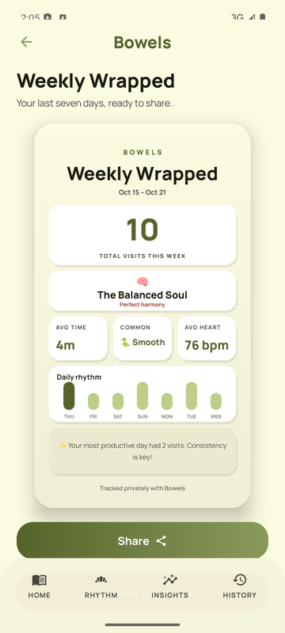
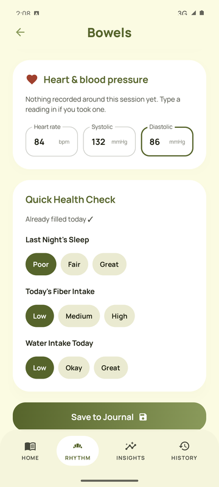
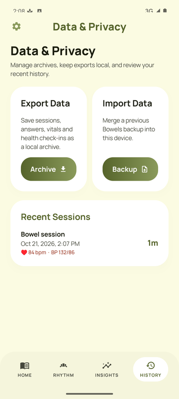
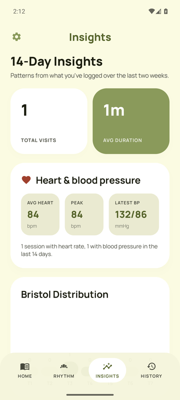
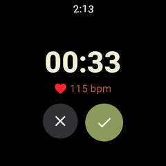
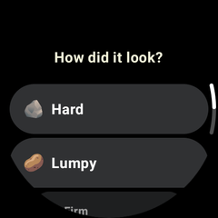
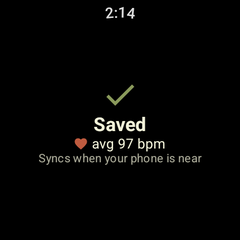
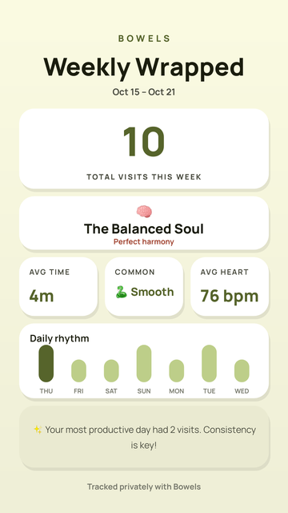

# Bowels

<div align="center">

### A calm, local-first digestive health tracker for Android and Wear OS

Log sessions in one tap, from your phone or your watch, see your heart rate and blood pressure from around each session, and build a steadier rhythm over time. No account, no cloud.











</div>

---

## What it does

| | |
|---|---|
| **Quick Log** | Save a bowel entry in one tap |
| **Sessions** | Time a session, finish it from the app or the notification, answer a few questions |
| **Wear OS watch** | Start and finish a session from your wrist when your phone is in another room. The watch measures your heart rate during the session and syncs to the phone by itself, even if the phone was out of range at the time |
| **Heart rate and blood pressure** | Read from Health Connect (Samsung Health, Fitbit, Pixel Watch, Omron and other cuffs write there) for the time of each session, or typed in. Read-only |
| **Daily health check** | Water, fiber, meals, stress, sleep, exercise, caffeine, alcohol, medication, mood |
| **Insights** | Gaps, pain, blood, urgency, hydration, stress and sleep patterns, and how straining affects your heart rate |
| **Weekly Wrapped** | Your week as a story-sized image to share or save |
| **Milestones** | Celebrate logged-day streaks, and share them |
| **Backups** | Export and import a JSON archive (2.x backups import too) |

Everything is stored on the device. There is no account and no server.



---

## Install

### Phone

Download `bowels-vX.Y.Z.apk` from the [latest release](https://github.com/Dawit-Sh/Bowels/releases/latest) and open it. Android asks once to allow installs from your browser or files app. Requires Android 8.0 or newer.

Updating from 2.x keeps all your data (sessions, health check-ins, milestones).

On first launch, **Begin** asks for notifications and for Health Connect's read access to heart rate and blood pressure, in the app, through the system's own permission sheets. Nothing has to be set up in settings.

### Watch (Wear OS 3 or newer)

Wear OS installs apps only from the Play Store, or from a computer over Wi-Fi with developer mode. Until Bowels is on the Play Store, use the second way. It takes about five minutes, once:

1. **Turn on developer mode on the watch.** Settings → System → About → Versions, then tap **Build number** seven times.
2. **Turn on wireless debugging.** Settings → Developer options → turn on **ADB debugging** and **Wireless debugging**. The watch and the computer must be on the same Wi-Fi.
3. **Get adb on the computer.** Download Google's [SDK Platform Tools](https://developer.android.com/tools/releases/platform-tools) and unzip them.
4. **Pair.** On the watch, open Wireless debugging → **Pair new device**. It shows an address and a code. On the computer, in the platform-tools folder:

   ```bash
   adb pair 192.168.1.23:41235
   ```

   Type the code when asked. Use the address the watch shows, not this example.

5. **Connect and install.** Wireless debugging's main screen shows another address (the port differs from the pairing one):

   ```bash
   adb connect 192.168.1.23:38021
   ```

   ```bash
   adb install bowels-wear-vX.Y.Z.apk
   ```

6. Turn **ADB debugging** off again to save battery. Bowels is now in the watch's app list.

Install the phone and watch APKs from the **same release**: they must be signed with the same key to find each other.

When you start your first session on the watch, it asks for heart-rate access in the same tap. Sessions you log on the watch show "saved, syncs when your phone is near" and land in the phone app on their own.

Once Bowels is on the Play Store (an internal testing track is enough), the phone app shows **Install on watch** when it finds a paired watch without Bowels, and installing becomes one tap.

---

## How it works

```text
.
|-- app/        Phone app (Jetpack Compose)
|   |-- data/       SQLite, repository, backups, local prefs
|   |-- domain/     Analytics, insights, content, demo data
|   |-- health/     Health Connect reads
|   |-- notify/     Reminders, weekly report, session and milestone notifications
|   |-- share/      1080x1920 share images
|   |-- wear/       Watch sync service and install prompt
|   |-- ui/         ViewModel, theme, components, screens
|-- wear/       Wear OS app (Compose for Wear, Health Services, Data Layer)
|-- shared/     The phone/watch sync contract
|-- docs/       GitHub Pages site and screenshots
```

**Watch sync.** The watch saves each finished session as a Wearable Data Layer item (`/bowels/session/<id>`). Google Play services keeps it on the watch and delivers it whenever the phone is reachable. The phone's `WatchSyncService` saves it (de-duplicated by id), looks up blood pressure in Health Connect, then deletes the item, which tells the watch it's synced.

**Vitals** are stored as ordinary session answers (`hr_avg`, `hr_min`, `hr_max`, `bp_systolic`, `bp_diastolic`, `bp_time` and their sources), so backups carry them with no format change. Watches and cuffs often sync to Health Connect late, so the app checks recent sessions again for a few hours.

**Upgrading from 2.x.** The app opens the same SQLite file the Expo app used (`files/SQLite/bowels.db`) and brings over the running session and announced milestones from AsyncStorage.

---

## Develop

Requirements: JDK 17 and the Android SDK (platform 35).

```bash
./gradlew assembleDebug
```

```bash
./gradlew :app:testDebugUnitTest
```

The tests cover analytics and insights, backup import (current and legacy formats), watch session sync and notification routing. They also render the share images to `app/build/share-previews/`.

Debug builds of the phone and watch share the debug key, so they sync with each other on a phone and a paired watch. Debug builds also let you fire reminders from a terminal:

```bash
adb shell am broadcast -n com.d_ave.bowels/.notify.ReminderReceiver -a com.d_ave.bowels.REMINDER_WEEKLY
```

CI runs the tests and builds both apps on every push to `main` and `kotlin`.

---

## Releases

Pushing a tag like `v3.0.0` builds signed phone and watch APKs and publishes them as a GitHub release. It needs the signing key in four repository secrets, and stops with an error if any is missing.

**Use the key the Expo builds were signed with.** Android only installs an update over an existing app when both are signed with the same key. A new key would make 2.x users uninstall first and lose their data.

1. Download the keystore from EAS (it asks you to pick the Android build profile and **Download existing keystore**; this also prints the alias and passwords):

   ```bash
   npx eas-cli credentials -p android
   ```

2. Add the secrets (from the folder with the downloaded `.jks`):

   ```bash
   gh secret set KEYSTORE_BASE64 -R Dawit-Sh/Bowels --body "$(base64 -w0 your-keystore.jks)"
   ```

   ```bash
   gh secret set KEYSTORE_PASSWORD -R Dawit-Sh/Bowels
   ```

   ```bash
   gh secret set KEY_ALIAS -R Dawit-Sh/Bowels
   ```

   ```bash
   gh secret set KEY_PASSWORD -R Dawit-Sh/Bowels
   ```

   The last three prompt for the value, so it doesn't end up in your shell history.

3. Tag and push:

   ```bash
   git tag v3.0.0 && git push origin v3.0.0
   ```

To build a signed release locally instead, put the same values in `keystore.properties` at the repo root (it's git-ignored):

```properties
storeFile=your-keystore.jks
storePassword=...
keyAlias=...
keyPassword=...
```

---

## Product principles

- Fast enough to use in the moment
- Calm instead of alarming
- Insightful without pretending certainty
- Private by default
- Useful even before you have a long history
- No setup: anything that can be connected is offered in one tap, in context

The earlier Expo / React Native version (2.x) is tagged [`expo-2.x`](https://github.com/Dawit-Sh/Bowels/tree/expo-2.x).
